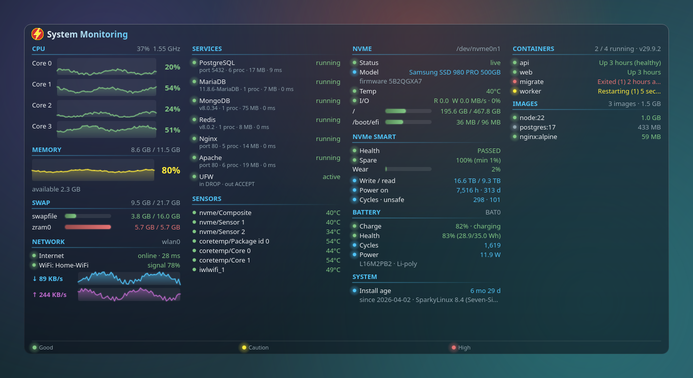
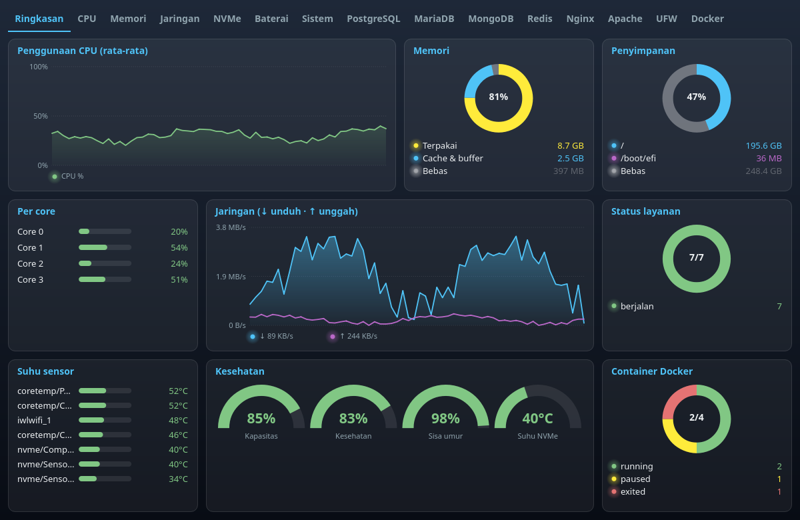
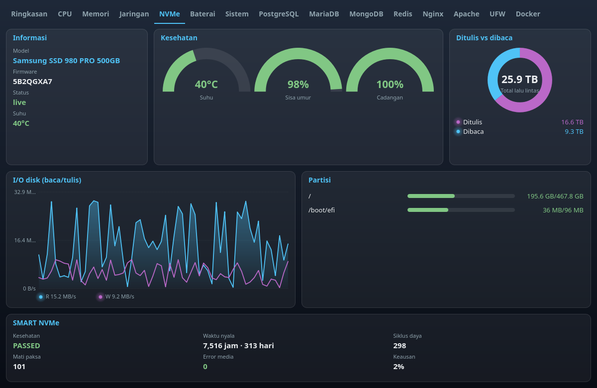
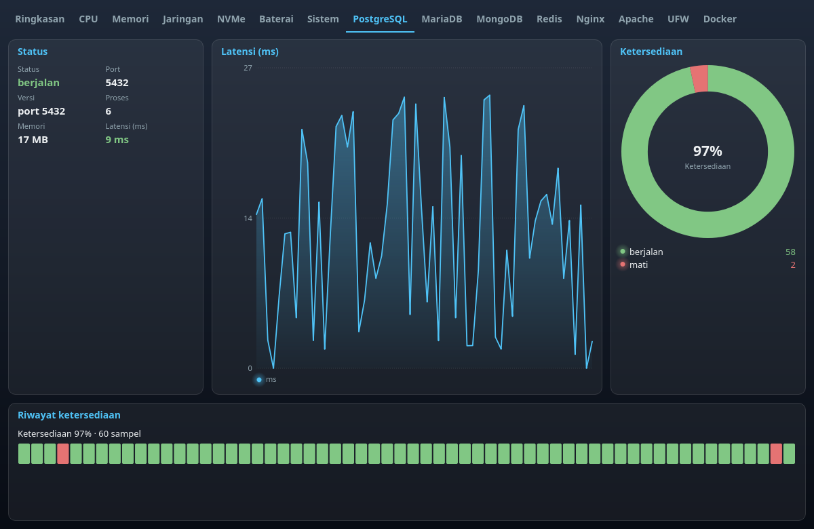
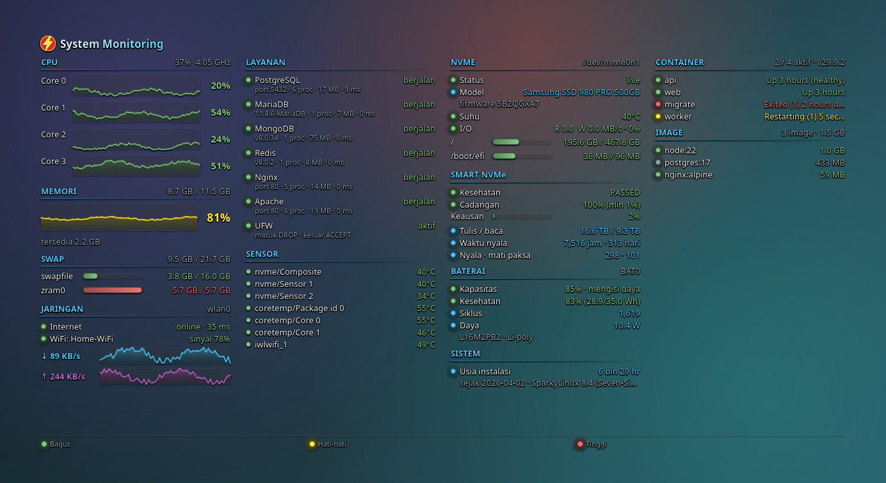
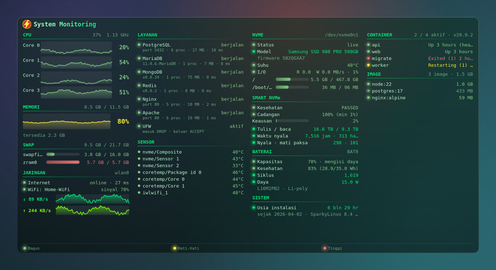

<div align="center">


# System Monitoring

**A system monitoring widget for the Linux desktop** — per-core CPU, RAM, network, NVMe + SMART, battery health, install age, sensors, databases, web servers, firewall and Docker, drawn right on top of your wallpaper.

[](LICENSE)


[🇮🇩 Bahasa Indonesia](README.md) · 🇬🇧 English



</div>

---

## ✨ Features

| | |
|---|---|
| 🧠 **CPU** | Per-core usage with history graphs, average and frequency |
| 💾 **Memory & Swap** | RAM, available memory, and every swap (swap file, zram) listed separately |
| 🌐 **Network** | Internet status + latency, WiFi SSID & signal, download/upload speed |
| ⚡ **NVMe** | Controller state, **SSD model** & firmware, temperature, read/write I/O, per-partition capacity |
| 🩺 **NVMe SMART** | Health, spare, wear, data written/read, power-on hours, power cycles, unsafe shutdowns |
| 🔋 **Battery** | Charge, **health** (full vs design), cycles, power draw, model |
| 🕰️ **Install age** | How long Linux has been installed on this computer |
| 📊 **Dashboard** | Separate window: overview with pie, bar and line charts, plus a **detail tab per service** |
| 🌡️ **Sensors** | All temperature sensors and fans |
| 🌐 **Web & firewall** | **Nginx**, **Apache**, **UFW** — status, version, processes, memory |
| 🗄️ **Databases** | **PostgreSQL**, **MariaDB**, **MongoDB**, **Redis** — status, version, processes, memory, latency |
| 🐳 **Docker** | Containers (state/health) and images (size, in use or not) |
| 🎨 **Look** | 8 themes (matching background + text colors), hide the background, always on top, 3 fonts, glow effects |
| 🚦 **Color indicators** | 🟢 good · 🟡 caution · 🔴 high |
| 🌍 **Two languages** | Indonesian and English, switch from the menu |
| 🔔 **System tray** | Tray icon, start at login (toggle on/off) |

No root required. Database checks use **no username/password** — they only verify that the server responds.

<details open>
<summary>📊 Dashboard</summary>

**Overview**



**NVMe tab** and **service tab** (PostgreSQL)




</details>

<details>
<summary>📸 More screenshots</summary>

**No background**



**Green (Matrix) theme + Monospace font**



> Screenshots are generated by `scripts/screenshots.py`. The history graphs, Docker containers and WiFi name shown are **demo data**.

</details>

## 📦 Installation

### Option 1 — `.deb` package (recommended)

Download the latest `.deb` from [Releases](../../releases), or straight from the [`dist/`](dist/) folder in this repo (`desktop-htop_<version>_all.deb`), then:

```bash
sudo apt install ./desktop-htop_*_all.deb
desktop-htop
```

Once installed, the widget **starts automatically at login**. If the launcher icon looks stale:

```bash
kbuildsycoca6 --noincremental   # KDE Plasma 6; or log out and back in
```

### Option 2 — run from source

```bash
sudo apt install python3-psutil python3-pyqt5 lm-sensors network-manager smartmontools
git clone https://github.com/<username>/<repo>.git
cd <repo>
python3 htop_widget.py
```

### Build the `.deb` yourself

Needs `dpkg-deb`, `python3`, `python3-pyqt5`, `python3-psutil` (plus `lintian`, `desktop-file-utils` for `make lint`). The version comes from the `VERSION` file. The build output in `dist/` is committed so anyone can use it right away.

```bash
make deb          # output: dist/desktop-htop_<version>_all.deb
make lint         # lintian + .desktop validation
```

## 🖱️ Usage

- **Drag** with the left mouse button to move the widget (position is saved).
- **Hover** any chart to see its values (line charts show a guide line; donut slices show the percentage).
- **Right-click** the widget or the tray icon for the menu.
- The **dashboard** opens right away when the app starts. **Left-click the tray icon** to hide/show it; closing the window only hides it (the app stays in the tray).
- The small desktop widget is optional: tick **Show desktop widget** in the menu.

| Menu | What it does |
|---|---|
| Lock position | Prevent accidental dragging |
| Open dashboard | Dashboard window: Overview tab + one tab per service (CPU, Memory, Network, NVMe, Battery, System, databases, web servers, UFW, Docker) |
| Show on top | Keep the widget in front of other windows (default: below them, above the wallpaper) |
| Show background | Turn off to draw text straight onto the wallpaper |
| Background opacity | Light / Medium / Solid |
| Monitored services | Per service: show/hide and **change port**; Docker: show/hide |
| Visual effects (glow) | Gradients, glow, fade-in |
| Theme | Default, Black, Blue, Green (Matrix), Amber, Purple, Red, Light — background and text colors change together |
| Font | Sans, Monospace, Serif |
| Language / Bahasa | Bahasa Indonesia, English |
| Update interval | 1 second, 5 seconds, 30 seconds, 1 minute |
| Start automatically at login | On/off |

> 💡 The **Light** theme (dark text) suits light wallpapers; turn the background off to draw text straight onto the wallpaper.

## ⚙️ Configuration

All choices are stored in `~/.config/desktop_htop.json`:

```json
{
  "x": 40, "y": 60,
  "opacity": 140, "show_bg": true, "fx": true,
  "theme": "Default", "font": "Sans", "lang": "en",
  "interval": 1, "locked": false,
  "services": {
    "PostgreSQL": {"show": true, "port": 5432},
    "MariaDB":    {"show": true, "port": 3306},
    "MongoDB":    {"show": true, "port": 27017},
    "Redis":      {"show": true, "port": 6379},
    "Nginx":      {"show": true, "port": 80},
    "Apache":     {"show": true, "port": 80},
    "UFW":        {"show": true},
    "Docker":     {"show": true}
  }
}
```

The autostart choice lives in `~/.config/autostart/desktop-htop.desktop` and overrides the package default. The initial language follows your system locale.

## 🔍 How it works

| Data | Source |
|---|---|
| CPU, RAM, network, sensors, battery | [`psutil`](https://github.com/giampaolo/psutil) |
| Swap | `/proc/swaps` |
| NVMe | `/sys/class/nvme/…` + `psutil` |
| NVMe SMART | `smartctl -j` (checked every 5 minutes) |
| Battery | `/sys/class/power_supply/BAT*` (health = `energy_full` / `energy_full_design`) |
| Install age | creation time of `/var/log/installer`, or the root filesystem (`stat %W`) |
| Nginx / Apache | `HEAD /` to the local port + process check |
| UFW | `/etc/ufw/ufw.conf` and `/etc/default/ufw` (no root; rule count only if readable) |
| WiFi (SSID, signal) | `nmcli` |
| Internet | TCP connect to `1.1.1.1:53` / `8.8.8.8:53` |
| PostgreSQL | `SSLRequest` on port 5432 |
| MariaDB / MySQL | reads the handshake greeting (server version) |
| MongoDB | `buildInfo` command (OP_MSG), no authentication needed |
| Redis | `PING` then `INFO server` (`-NOAUTH` still counts as up) |
| Docker | Engine API over `/var/run/docker.sock` (user must be in the `docker` group) |

Service checks run in a background thread and only for services that are shown, so the UI stays light.

## ⚠️ Limitations

- Tested on **Debian 13 + KDE Plasma (X11)**. On Wayland, "below all windows" placement may behave differently.
- NVMe **SMART** needs root. Once `smartmontools` is installed, click the **Root login…** button in the SMART section (enter the root password; it is not stored), or run `sudo desktop-htop-smart-setup` once (adds a narrow sudoers rule for one read-only command; revoke with `--remove`). `/dev/nvme0` only.
- Install age is an estimate from the filesystem / installer log creation time.
- Docker: no per-container CPU/memory yet.
- Database process count and memory are matched by local process name; a database inside a Docker container only shows its port status.

## 🛠️ Troubleshooting

| Problem | Fix |
|---|---|
| Dashboard is not visible | Click the tray icon, or right-click → **Show / hide dashboard** |
| Desktop widget is not visible | Tick **Show desktop widget**. It sits below all windows; show the desktop or enable **Show on top** |
| No tray icon | Make sure *System Tray* is enabled in your panel |
| SMART: "smartctl is not installed" | `sudo apt install smartmontools` |
| SMART: "root access needed" | Click **Root login…** and enter the root password, or run `sudo desktop-htop-smart-setup`. If the root account is locked (Ubuntu), use `sudo desktop-htop-smart-setup` |
| Docker: "permission denied" | `sudo usermod -aG docker $USER`, then log in again |
| Stale launcher icon | `kbuildsycoca6 --noincremental` or log in again |
| Won't autostart | Check **Start automatically at login** in the menu |

## 🗺️ Roadmap

- [ ] Per-container Docker CPU/memory
- [ ] GPU support (NVIDIA/AMD)
- [ ] Notifications when a value crosses a threshold
- [ ] Configurable color thresholds

## 🤝 Contributing

Issues and pull requests are welcome. Repo layout:

```
htop_widget.py      # the whole app (PyQt5)
packaging/          # Debian package tree (control, .desktop, icons, man page)
scripts/            # build-deb.sh, make_icons.py, screenshots.py
docs/               # logo and screenshots
.github/workflows/  # CI: build the .deb
```

Translations live in the `I18N` catalog in `htop_widget.py` — adding a language means adding one column.

## 📄 License

[GPL-3.0](LICENSE) © 2026 Suryo Adhy Chandra

The lightning-bolt icon is an original drawing and is not any company's official logo.
