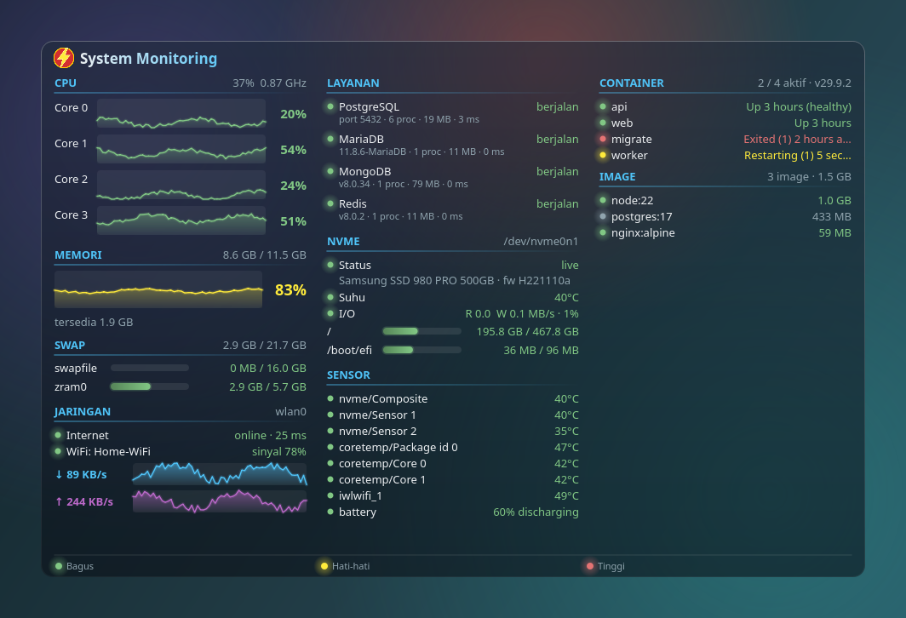
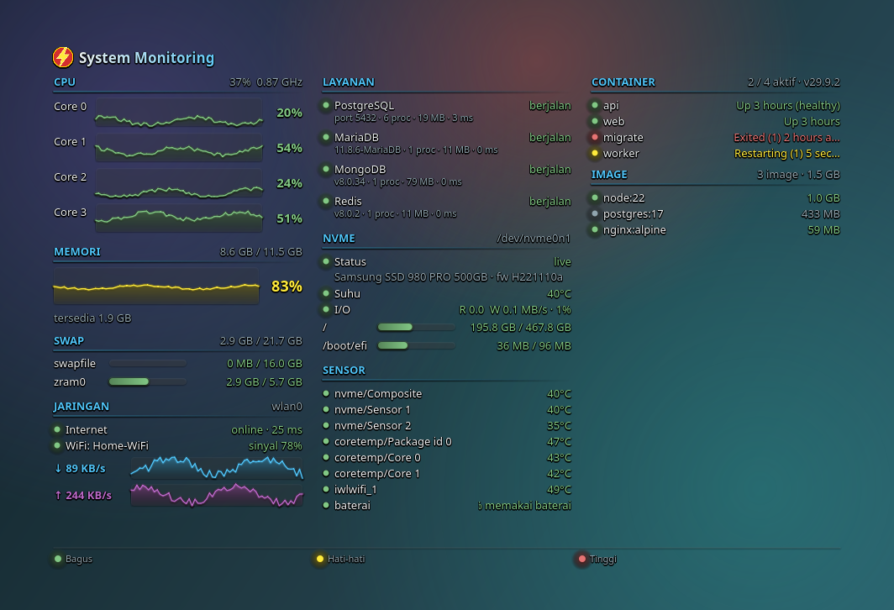
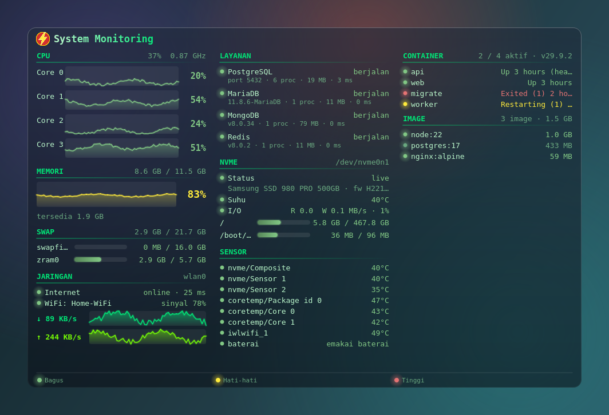
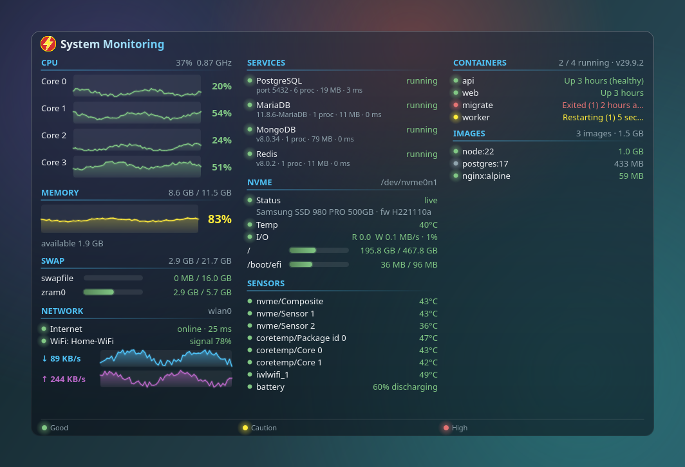

<div align="center">


# System Monitoring

**Widget monitor sistem untuk desktop Linux** — CPU per core, RAM, jaringan, NVMe, sensor, database, dan Docker, langsung di atas wallpaper kamu.

[](LICENSE)


🇮🇩 Bahasa Indonesia · [🇬🇧 English](README.en.md)



</div>

---

## ✨ Fitur

| | |
|---|---|
| 🧠 **CPU** | Penggunaan tiap core dengan grafik riwayat, rata-rata, dan frekuensi |
| 💾 **Memori & Swap** | RAM, memori tersedia, dan semua swap (swap file, zram) terpisah |
| 🌐 **Jaringan** | Status internet + latensi, SSID & sinyal WiFi, kecepatan download/upload |
| ⚡ **NVMe** | Status controller, model & firmware, suhu, I/O baca/tulis, kapasitas tiap partisi |
| 🌡️ **Sensor** | Semua sensor suhu, kipas, dan baterai |
| 🗄️ **Database** | **PostgreSQL**, **MariaDB**, **MongoDB**, **Redis** — status, versi, proses, memori, latensi |
| 🐳 **Docker** | Daftar container (status/health) dan image (ukuran, sedang dipakai atau tidak) |
| 🎨 **Tampilan** | Hilangkan background, 6 tema tulisan, 3 font, efek glow |
| 🚦 **Indikator warna** | 🟢 bagus · 🟡 hati-hati · 🔴 tinggi |
| 🌍 **Dua bahasa** | Indonesia dan English, ganti dari menu |
| 🔔 **System tray** | Ikon di tray, autostart saat login (bisa diatur on/off) |

Tidak butuh root. Cek database **tanpa username/password** — hanya memeriksa apakah server merespons.

<details>
<summary>📸 Lebih banyak tampilan</summary>

**Tanpa background**



**Tema Hijau (Matrix) + font Monospace**



**English**



> Screenshot dibuat dengan `scripts/screenshots.py`. Grafik riwayat, container Docker, dan nama WiFi di gambar adalah **data demo**.

</details>

## 📦 Instalasi

### Opsi 1 — paket `.deb` (disarankan)

Unduh `.deb` terbaru dari halaman [Releases](../../releases), lalu:

```bash
sudo apt install ./desktop-htop_*_all.deb
desktop-htop
```

Setelah terpasang, widget **jalan otomatis saat login**. Kalau ikon di launcher belum berubah:

```bash
kbuildsycoca6 --noincremental   # KDE Plasma 6; atau login ulang
```

### Opsi 2 — jalankan dari source

```bash
sudo apt install python3-psutil python3-pyqt5 lm-sensors network-manager
git clone https://github.com/<username>/<repo>.git
cd <repo>
python3 htop_widget.py
```

### Build `.deb` sendiri

```bash
make deb          # hasil: dist/desktop-htop_<versi>_all.deb
make lint         # lintian + validasi .desktop
```

## 🖱️ Cara pakai

- **Drag** dengan klik kiri untuk memindahkan widget (posisi tersimpan).
- **Klik kanan** widget atau ikon tray untuk membuka menu.
- **Klik kiri ikon tray** untuk menyembunyikan/menampilkan widget.

| Menu | Fungsi |
|---|---|
| Kunci posisi | Cegah widget tergeser tidak sengaja |
| Tampilkan background | Matikan untuk teks langsung di atas wallpaper |
| Transparansi background | Tipis / Sedang / Pekat |
| Layanan monitoring | Per layanan: tampilkan/sembunyikan dan **ubah port**; Docker: tampilkan/sembunyikan |
| Efek visual (glow) | Gradasi, glow, fade-in |
| Tema tulisan | Default, Putih, Gelap, Hijau (Matrix), Amber, Ungu |
| Jenis font | Sans, Monospace, Serif |
| Bahasa / Language | Bahasa Indonesia, English |
| Interval update | 1 detik, 5 detik, 30 detik, 1 menit |
| Jalankan otomatis saat login | On/off |

> 💡 Tema **Gelap** dibuat untuk wallpaper terang dengan background dimatikan.

## ⚙️ Konfigurasi

Semua pilihan disimpan di `~/.config/desktop_htop.json`:

```json
{
  "x": 40, "y": 60,
  "opacity": 140, "show_bg": true, "fx": true,
  "theme": "Default", "font": "Sans", "lang": "id",
  "interval": 1, "locked": false,
  "services": {
    "PostgreSQL": {"show": true, "port": 5432},
    "MariaDB":    {"show": true, "port": 3306},
    "MongoDB":    {"show": true, "port": 27017},
    "Redis":      {"show": true, "port": 6379},
    "Docker":     {"show": true}
  }
}
```

Autostart disimpan di `~/.config/autostart/desktop-htop.desktop` dan menimpa pengaturan bawaan paket.

## 🔍 Cara kerja

| Data | Sumber |
|---|---|
| CPU, RAM, jaringan, sensor, baterai | [`psutil`](https://github.com/giampaolo/psutil) |
| Swap | `/proc/swaps` |
| NVMe | `/sys/class/nvme/…` + `psutil` |
| WiFi (SSID, sinyal) | `nmcli` |
| Internet | koneksi TCP ke `1.1.1.1:53` / `8.8.8.8:53` |
| PostgreSQL | `SSLRequest` ke port 5432 |
| MariaDB / MySQL | membaca handshake greeting (versi server) |
| MongoDB | perintah `buildInfo` (OP_MSG), tanpa autentikasi |
| Redis | `PING` lalu `INFO server` (`-NOAUTH` tetap dianggap hidup) |
| Docker | Engine API lewat `/var/run/docker.sock` (user harus ada di grup `docker`) |

Pengecekan layanan jalan di thread terpisah dan hanya untuk layanan yang ditampilkan, jadi UI tetap ringan.

## ⚠️ Batasan

- Diuji di **Debian 13 + KDE Plasma (X11)**. Di Wayland, penempatan window "di bawah semua window" bisa berbeda.
- Status kesehatan **SMART** NVMe (wear level, sisa umur) belum ada karena butuh root.
- Docker: belum menampilkan CPU/memori per container.
- Jumlah proses & memori database dihitung dari nama proses lokal; database di dalam container Docker hanya terlihat statusnya lewat port.

## 🛠️ Troubleshooting

| Masalah | Solusi |
|---|---|
| Widget tidak kelihatan | Widget berada di bawah semua window. Tampilkan desktop atau klik ikon tray |
| Ikon tray tidak muncul | Pastikan *System Tray* aktif di panel |
| Docker: "akses ditolak" | `sudo usermod -aG docker $USER`, lalu login ulang |
| Ikon launcher lama | `kbuildsycoca6 --noincremental` atau login ulang |
| Tidak mau autostart | Cek centang **Jalankan otomatis saat login** di menu |

## 🗺️ Rencana

- [ ] Status SMART NVMe (lewat helper berhak akses)
- [ ] CPU/memori per container Docker
- [ ] Dukungan GPU (NVIDIA/AMD)
- [ ] Peringatan notifikasi saat nilai melewati ambang
- [ ] Ambang warna yang bisa diatur

## 🤝 Kontribusi

Issue dan pull request dipersilakan. Struktur repo:

```
htop_widget.py      # seluruh aplikasi (PyQt5)
packaging/          # pohon paket Debian (control, .desktop, ikon, man page)
scripts/            # build-deb.sh, make_icons.py, screenshots.py
docs/               # logo dan screenshot
.github/workflows/  # CI: build .deb
```

Terjemahan ada di katalog `I18N` pada `htop_widget.py` — menambah bahasa cukup menambah satu kolom.

## 📄 Lisensi

[GPL-3.0](LICENSE) © 2026 Suryo Adhy Chandra

Ikon petir adalah gambar sendiri dan bukan logo resmi pihak mana pun.
